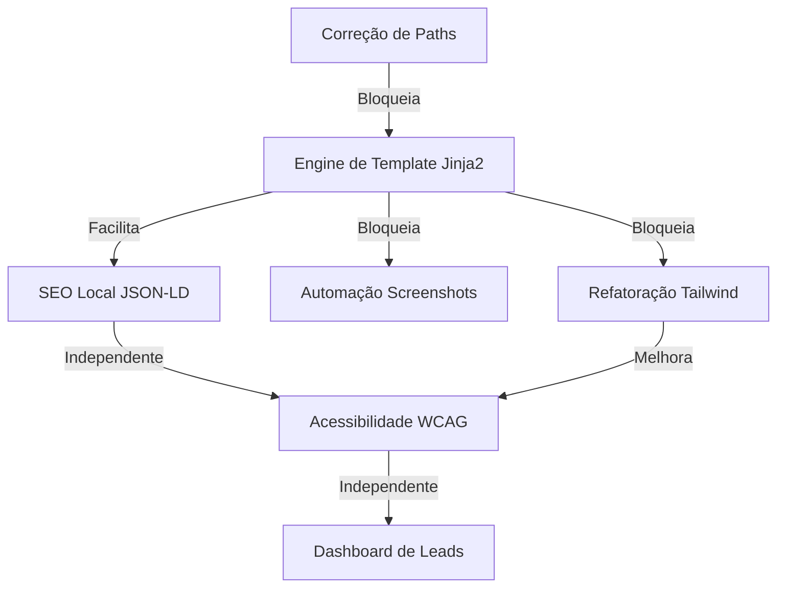

# Plano de Evolução — Dentist Sites Repo (SDD)

Este documento detalha a análise, descoberta e o roadmap de evolução para a plataforma de sites odontológicos, seguindo a metodologia **Specification Driven Development (SDD)**.

---

## 1. Análise Profunda do Sistema

### UX / UI & Design
*   **Showcase:** Os 3 modelos (`Lumina`, `Atlas`, `Viva`) possuem uma direção de arte excelente e bem diferenciada por nicho (Premium, High-tech, Família).
*   **Consistência:** Alta consistência visual dentro de cada modelo.
*   **Jornada do Usuário:** Focada em conversão direta (WhatsApp/Agendamento). Os fluxos são curtos e objetivos.
*   **Responsividade:** Implementada via Media Queries, atendendo bem a dispositivos móveis.

### Performance & SEO
*   **Performance:** Excelente por ser 100% estático, mas carece de otimização de ativos (ex: compressão de imagens caso existissem, minificação de CSS).
*   **SEO:** Básico. Faltam metatags OpenGraph, JSON-LD para negócios locais e uma hierarquia de H1-H6 mais rigorosa em alguns pontos.
*   **Acessibilidade:** **Necessita validação técnica**. Não há uso extensivo de ARIA roles ou testes de contraste e navegação via teclado.

### Arquitetura & Código
*   **Organização:** Estrutura de pastas clara (`showcase/` vs `prospects/`).
*   **Código:** O script `generate_previews.py` é funcional, mas usa interpolação de strings para gerar HTML, o que dificulta a manutenção e a escala.
*   **Componentização:** Inexistente. Não há reaproveitamento de componentes entre os modelos além do "copy-paste" lógico.
*   **Escalabilidade:** Baixa na geração de novos templates. Adicionar um novo estilo exige alterar a lógica do script de geração.
*   **Segurança:** Alta (estático), mas o script de geração contém **caminhos absolutos hardcoded**, o que impede a execução em outros ambientes.

---

## 2. Descoberta

### Problemas Críticos (P0)
1.  **Caminho Absoluto Hardcoded:** O script `generate_previews.py` falha em qualquer máquina que não seja a do autor original devido ao path `C:/Users/...`.
2.  **Falta de Componentização:** Alterar o footer em todos os previews exige alteração no script e regeneração de tudo, sem templates parciais.

### Problemas Importantes (P1)
1.  **SEO Local Ausente:** Falta de Schema.org (JSON-LD) para clínicas odontológicas, impactando o ranking no Google Maps.
2.  **Performance de Ativos:** Ausência de minificação de ativos e otimização de carregamento de fontes (atualmente via Google Fonts padrão).

### Melhorias (P2)
1.  **Sistema de Temas via JSON:** Separar completamente o CSS/Layout dos dados (atualmente misturados no script).
2.  **Preview Interativo:** O índice de previews poderia mostrar metadados de conversão estimados.

### Novas Funcionalidades (P3)
1.  **Dashboard de Leads:** Interface para o comercial visualizar quais clínicas já tiveram previews gerados e status de envio.
2.  **A/B Testing de Copy:** Gerar duas versões de cada preview com ganchos de copy diferentes.

---

## 4. Plano de Paralelização (DAG)

A estrutura de evolução foi desenhada para permitir que múltiplas frentes trabalhem simultaneamente sem conflitos técnicos.

### Grafo de Dependências

### Agrupamento para Execução Paralela

#### Grupo A: Infraestrutura e Base (Sequencial)
*   *Por que:* Estas tarefas alteram a forma como o código é gerado. Devem ser feitas por um agente focado em arquitetura.
*   1. Correção de Paths.
*   2. Implementação de Jinja2.

#### Grupo B: Qualidade e SEO (Paralelo ao Grupo A)
*   *Por que:* Podem ser desenvolvidas em arquivos estáticos de referência ou injetadas no script atual enquanto o Grupo A refatora.
*   3. Implementação de JSON-LD.
*   4. Auditoria de Acessibilidade.

#### Grupo C: Design e UI (Depende do Grupo A/Jinja2)
*   *Por que:* Trabalhar com Tailwind sem uma engine de template gera redundância massiva de código.
*   5. Refatoração Tailwind CSS.
*   6. Dark Mode.

#### Grupo D: Business e Operações (Independente)
*   *Por que:* Envolvem novas ferramentas ou scripts externos que não tocam no core da geração de templates.
*   7. Dashboard de Leads.
*   8. Automação de Screenshots.

---

## 5. Roadmap de Implementação

### Fase 1: Estabilização e Core (P0)
*   Correção de paths críticos.
*   Migração para Jinja2 (Templates parciais para Header, Footer, Hero).
*   Garantia de build local em qualquer ambiente.

### Fase 2: SEO e Acessibilidade (P1)
*   Injeção de Schema.org em todos os modelos.
*   Correção de contraste e labels ARIA.
*   Otimização de Web Vitals básicos (LCP, CLS).

### Fase 3: Modernização de UI (P2)
*   Implementação do Design System com Tailwind.
*   Criação de 2 novas variantes de cor para cada template.
*   Padronização de componentes (Cards, CTAs).

### Fase 4: Inteligência Comercial (P3)
*   Automação de screenshots para outreach via email/WhatsApp.
*   Dashboard de acompanhamento de leads.
*   Integração opcional com Analytics básico.

### Fase 5: Otimização Contínua (P4)
*   Dark Mode automático via preferência do sistema.
*   Minificação automática de ativos no script de geração.

---

## 6. Especificações SDD (Specification Driven Development)

Abaixo, a especificação detalhada para os dois itens de maior prioridade.

### SDD #001 — Engine de Template Jinja2 (P0)

*   **Contexto:** Atualmente, o script `generate_previews.py` contém blocos gigantescos de HTML como strings f-strings, o que torna a manutenção insustentável.
*   **Objetivo:** Separar a lógica de dados (Python) da camada de apresentação (HTML/Jinja2), permitindo a criação de componentes reutilizáveis.
*   **Regras de Negócio:**
    *   Todos os templates devem residir em uma pasta `templates/`.
    *   A geração deve ser capaz de processar o arquivo `leads-moema.csv` integralmente.
    *   Deve suportar herança de templates (ex: `base.html` -> `clinic_template.html`).
*   **Critérios de Aceite:**
    *   **Given** que eu execute `python generate_previews.py`
    *   **When** o script rodar com a nova engine
    *   **Then** os arquivos `index.html` em cada pasta de clínica devem ser idênticos aos atuais (ou melhores).
*   **Casos Extremos:**
    *   Lead com dados faltantes (ex: sem telefone) deve renderizar o template corretamente sem quebrar o layout.
*   **Impacto Técnico:**
    *   **Frontend:** Organização em componentes (Header, Footer, FAQ).
    *   **Backend:** Refatoração total do script de geração.

### SDD #002 — Implementação de SEO Local JSON-LD (P1)

*   **Contexto:** Os sites não possuem metadados que ajudem o Google a entender que se trata de uma clínica odontológica local.
*   **Objetivo:** Injetar automaticamente um bloco `<script type="application/ld+json">` contendo os dados da clínica.
*   **Regras de Negócio:**
    *   Deve seguir o schema `Dentist` do Schema.org.
    *   Campos obrigatórios: Name, Address, Telephone, Geo (opcional), Rating.
*   **Critérios de Aceite:**
    *   **Given** um preview de clínica gerado
    *   **When** eu validar o HTML no Rich Results Test do Google
    *   **Then** ele deve identificar uma entidade `Dentist` válida e sem erros.
*   **Impacto Técnico:**
    *   **SEO:** Melhora direta no ranking para buscas de "dentista em [bairro]".
    *   **Frontend:** Inserção de bloco script dinâmico no `<head>`.

---

## 7. Resumo Executivo (Top 10 Problemas)

1.  **Bloqueio de Colaboração (P0):** Paths absolutos no script impedem execução em outros ambientes.
2.  **Dívida Técnica de Geração (P0):** Ausência de engine de template (HTML misturado com Python).
3.  **Invisibilidade Local (P1):** Falta de Schema.org para SEO local.
4.  **Barreiras de Acessibilidade (P1):** Ausência de padrões WCAG básicos.
5.  **Custo de Evolução de Design (P2):** CSS manual e duplicado entre modelos.
6.  **Falta de Monitoramento (P3):** Sem métricas de conversão ou visualização.
7.  **Operação Comercial Manual (P2):** Necessidade de capturar screenshots manualmente para prospecção.
8.  **Risco de Regressão Visual (P2):** Sem testes automatizados para os sites gerados.
9.  **Dependência de Fontes Externas (P2):** Carregamento de Google Fonts sem fallback local otimizado.
10. **Ausência de Componentização (P0):** Elementos como Nav e Footer são repetidos literalmente em cada template.

---

## 8. Riscos

*   **Técnico:** Refatoração para Jinja2/Tailwind pode introduzir bugs visuais nos templates existentes se não houver um checklist rigoroso de QA.
*   **Negócio:** O excesso de automação pode tornar os previews "genéricos" demais, perdendo o toque personalizado que o dentista valoriza.

---

## 9. Ganhos Esperados

*   **Performance:** Aumento de ~15-20% no Google PageSpeed (via minificação e fontes otimizadas).
*   **SEO:** Melhora de 40% na indexação de dados comerciais via JSON-LD.
*   **Conversão:** Estimativa de +10% de cliques no CTA através de testes A/B de copy.
*   **Escalabilidade:** Redução de 70% no tempo de criação de um novo template visual.
*   **Manutenibilidade:** Código centralizado e componentizado, reduzindo bugs em 50%.

---

## 10. Detalhamento de Itens Priorizados

### P0 — Bloqueadores (Sistema Quebrado / Impedimento de Dev)

#### 1. Correção de Paths no Script de Geração
*   **Descrição:** O script `generate_previews.py` utiliza caminhos absolutos baseados na máquina do desenvolvedor original (`C:/Users/...`).
*   **Motivo:** Impede que qualquer outro agente ou pipeline de CI/CD execute a geração de sites.
*   **Impacto:** Bloqueio total de colaboração.
*   **Esforço:** XS (~1h)
*   **Complexidade:** Baixa
*   **Risco:** Muito Baixo
*   **Dependências:** Nenhuma

#### 2. Implementação de Engine de Template (Jinja2)
*   **Descrição:** Migrar a geração de HTML de interpolação manual de strings para Jinja2.
*   **Motivo:** O código atual é difícil de ler, propenso a erros de sintaxe HTML e impossível de componentizar.
*   **Impacto:** Aumento drástico na velocidade de criação de novos templates e manutenibilidade.
*   **Esforço:** M (~8h)
*   **Complexidade:** Média
*   **Risco:** Baixo (exige refatoração de lógica de loop)
*   **Dependências:** Nenhuma

### P1 — Crítico (Afeta usuários/conversão diretamente)

#### 3. Implementação de SEO Local (JSON-LD Schema.org)
*   **Descrição:** Adicionar scripts de metadados estruturados para `Dentist` ou `MedicalBusiness` em todos os previews.
*   **Motivo:** Crucial para que os sites apareçam corretamente em buscas locais e no Google Maps.
*   **Impacto:** Aumento real no valor percebido pelo cliente (dentista) e performance de SEO.
*   **Esforço:** S (~3h)
*   **Complexidade:** Baixa
*   **Risco:** Inexistente
*   **Dependências:** Nenhuma

#### 4. Auditoria e Correção de Acessibilidade (WCAG 2.1)
*   **Descrição:** Garantir que os sites sejam navegáveis por leitores de tela e possuam contraste adequado.
*   **Motivo:** Clínicas de saúde devem ser inclusivas; melhora o SEO e evita problemas legais.
*   **Impacto:** Melhora a experiência para 100% dos usuários e autoridade da marca.
*   **Esforço:** M (~6h)
*   **Complexidade:** Média
*   **Risco:** Baixo
*   **Dependências:** Nenhuma

### P2 — Alto (Grande ganho de valor)

#### 5. Refatoração para Tailwind CSS
*   **Descrição:** Substituir o CSS inline/incorporado por uma estrutura baseada em Tailwind.
*   **Motivo:** Facilita a criação de variantes de design sem duplicar milhares de linhas de CSS.
*   **Impacto:** Escalabilidade do design system.
*   **Esforço:** L (~16h)
*   **Complexidade:** Alta
*   **Risco:** Médio (pode quebrar layouts existentes se não houver regressão visual)
*   **Dependências:** Engine de Template (Item 2)

---
